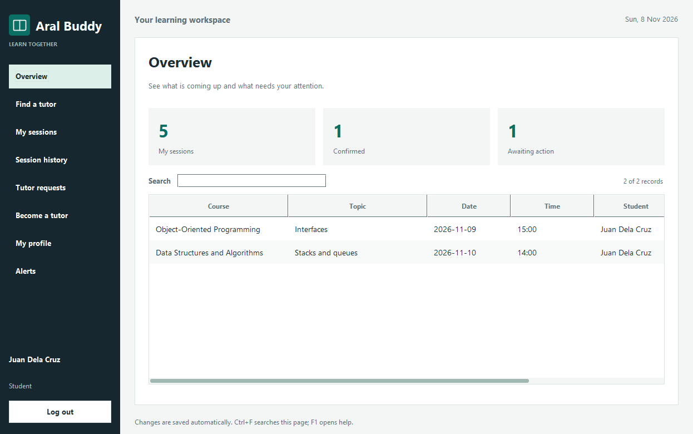
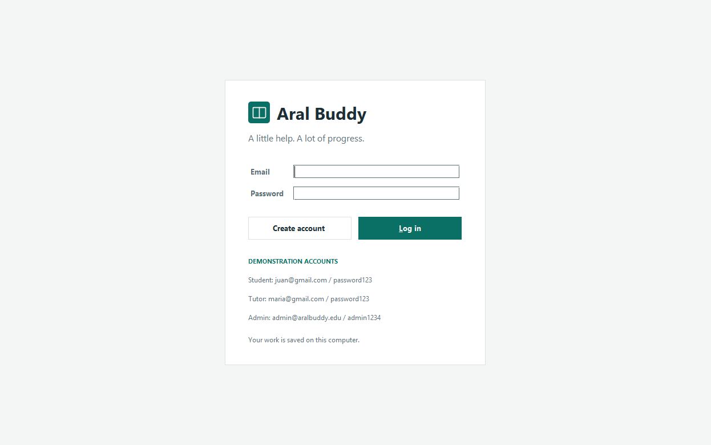
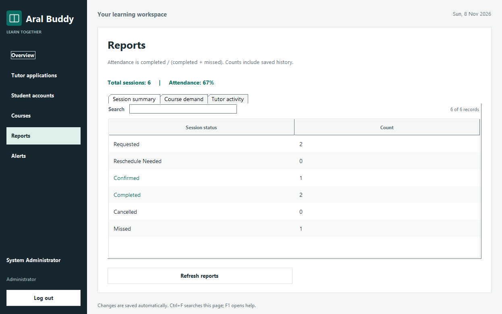
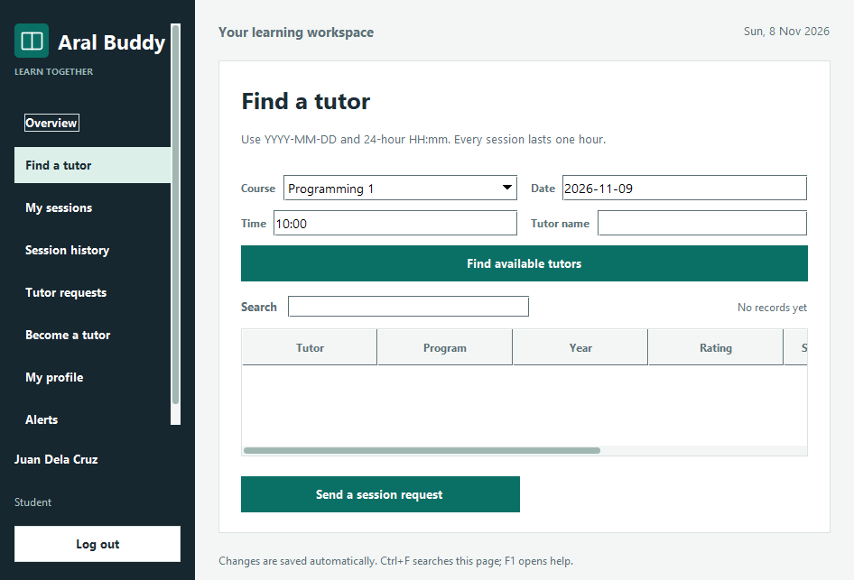

# Aral Buddy

**A Peer Tutoring Matching and Scheduling System**

Our integrated final project for **Information Management**, **Data Structures and Algorithms**, and **Object-Oriented Programming**, developed for the **first semester of our second year in Bachelor of Science in Information Technology (BSIT)**.




## About the project

Aral Buddy helps students connect with peer tutors, request study sessions, and keep track of their learning activities. Students can find tutors based on their course and available schedule, while tutors can manage requests and record session attendance. Administrators review tutor applications, manage accounts and courses, and view activity reports.

Our group developed this project to bring together the concepts we learned in three courses through one practical desktop application. It combines organized information handling, custom data structures, and object-oriented design in a system that supports students helping other students.

The application is built entirely with **Java Swing and the standard Java library**. It runs locally and saves records on the computer. It does not require a database server, an internet connection, or third-party Java libraries.

## Contents

- [Course integration](#course-integration)
- [Features](#features)
- [Screenshots](#screenshots)
- [Getting started](#getting-started)
- [Demo accounts](#demo-accounts)
- [Project structure](#project-structure)
- [How the application works](#how-the-application-works)
- [Data storage](#data-storage)
- [Testing](#testing)
- [Documentation](#documentation)

## Course integration

| Course | Concepts applied | Examples in Aral Buddy |
| --- | --- | --- |
| **Information Management** | Record organization, unique identifiers, relationships, validation, persistence, and reporting | Student and tutor accounts, course records, linked session participants, saved applications, attendance summaries, and local file backups |
| **Data Structures and Algorithms (DSA)** | Linked nodes, singly linked lists, FIFO queues, traversal, and linear search | A custom session list and a custom queue that processes the oldest pending tutor request first |
| **Object-Oriented Programming (OOP)** | Classes and objects, encapsulation, inheritance, abstraction, polymorphism, and separation of responsibilities | The `User`, `Admin`, `Student`, and `Tutor` hierarchy, shared page abstractions, and separate model, view, controller, and service packages |

The Information Management component uses **file-based persistence**. This version does not use SQL or a relational database server. See [Architecture and Course Integration](docs/ARCHITECTURE.md) for the implementation details and data-structure costs.

## Features

### Students

- Register an account and update their profile.
- Search for tutors by course, name, date, and time.
- Send tutoring requests with a topic and meeting venue or link.
- Reschedule eligible requests or cancel open sessions.
- View completed, missed, and cancelled session history.
- Submit a rating and feedback after a completed session.
- Apply to become a tutor and track the review decision.
- Receive in-app updates about sessions and applications.

### Peer tutors

- Keep access to student features after tutor approval.
- Receive requests based on their approved courses and weekly availability.
- Accept or decline the oldest pending request through a FIFO queue.
- Record whether a confirmed session was completed or missed.
- View session history, ratings, and feedback.

### Administrators

- Review and approve or reject tutor applications.
- Activate or deactivate student and tutor accounts.
- Add courses and remove courses that are no longer referenced by open work or tutor offerings.
- View session totals, attendance rates, course demand, and tutor activity.
- See pending applications and session-request alerts.

### Shared improvements

- **Saved work:** accounts, applications, bookings, attendance, ratings, and feedback survive a restart.
- **Safer scheduling:** the whole hour must fit tutor availability, and overlapping confirmed sessions are rejected for both participants.
- **Searchable tables:** live filtering, sortable columns, readable rows, and full-text tooltips.
- **Responsive interface:** background loading, saving, and password checks with `SwingWorker`.
- **Consistent design:** a resizable sidebar layout, shared colors and typography, confirmation dialogs, and keyboard shortcuts.
- **Password protection:** salted PBKDF2 password hashes instead of stored plain text passwords.

## Screenshots

The images below are renders of the actual Swing components using the included demonstration records.

<details>
<summary><strong>Login screen</strong></summary>



</details>

<details>
<summary><strong>Administrator reports</strong></summary>



</details>

<details>
<summary><strong>Tutor search at the minimum window size</strong></summary>



</details>

## Getting started

### Requirements

- **JDK 17 or newer**, with `java`, `javac`, and `jar` available on `PATH`.
- A desktop environment capable of displaying Java Swing windows.
- Windows PowerShell for the provided Windows build and test scripts.

This repository contains source code. Compiled classes, generated JARs, and personal saved data are excluded from version control.

### Run on Windows

1. Clone the repository or download and extract its ZIP.
2. Open **`Run.cmd`** from the project root.
3. On the first run, the script builds `dist/AralBuddy.jar` and starts the application.

Use **`Build.cmd`** to rebuild after changing the source. Use **`Test.cmd`** to build and run the checks.

Alternatively, from PowerShell in the project root:

```powershell
powershell.exe -NoProfile -ExecutionPolicy Bypass -File .\scripts\build.ps1
java -jar .\dist\AralBuddy.jar
```

### Build manually on macOS or Linux

From a terminal in the project root:

```sh
mkdir -p build/classes dist
find src -name '*.java' > build/sources.txt
javac --release 17 -encoding UTF-8 -d build/classes @build/sources.txt
jar --create --file dist/AralBuddy.jar --main-class aralbuddy.Main -C build/classes .
java -jar dist/AralBuddy.jar
```

### Run in an IDE

Open the project with JDK 17 or newer, mark `src` as the source folder, and run [`aralbuddy.Main`](src/aralbuddy/Main.java). No external dependencies need to be imported.

## Demo accounts

These are seeded local demonstration accounts. They are not connected to Gmail or a school account service.

| Role | Email | Password |
| --- | --- | --- |
| Student | `juan@gmail.com` | `password123` |
| Peer tutor | `maria@gmail.com` | `password123` |
| Administrator | `admin@aralbuddy.edu` | `admin1234` |
| Student with a pending tutor application | `liza@gmail.com` | `password123` |

Additional tutors are available as `ana@gmail.com` and `carlo@gmail.com`, both with `password123`.

Demo records are created only when the selected data folder has no saved workspace. Upcoming demo sessions use dates relative to that first launch. Later launches keep the saved dates and changes.

For a fresh demonstration in a separate folder:

```sh
java -Daralbuddy.dataDir=demo-data -jar dist/AralBuddy.jar
```

## Project structure

```text
AralBuddy/
|-- src/aralbuddy/
|   |-- Main.java              Application entry point
|   |-- model/                 Accounts, courses, sessions, and custom data structures
|   |-- view/                  Swing screens, tables, dialogs, and theme
|   |-- controller/            UI actions and background tasks
|   |-- service/               Business rules, demo records, and local storage
|   `-- util/                  Input validation and password hashing
|-- test/aralbuddy/             Dependency-free service and GUI checks
|-- scripts/                   PowerShell build and test scripts
|-- docs/                      Architecture, presentation, testing, and repository details
|-- assets/screenshots/         Images used in this README
|-- Build.cmd                  Windows build shortcut
|-- Run.cmd                    Windows run shortcut
|-- Test.cmd                   Windows test shortcut
|-- .gitignore                 Excludes generated files and local application data
|-- .gitattributes             Consistent text and script line endings
|-- .editorconfig              Shared formatting settings
`-- README.md
```

`build/` and `dist/` are created when the project is built. They are not part of the source upload.

## How the application works

1. **Startup:** `Main` creates the window on the Swing event thread.
2. **Loading:** the controller starts a worker that loads saved records or prepares the first-run demo workspace.
3. **Login:** the service verifies the password hash and active account state. The role determines the available pages.
4. **Actions:** a view collects form values; the controller asks the service to apply the operation in a worker.
5. **Validation and saving:** the service checks permissions and business rules, then saves the complete change. Failed operations restore the previous state.
6. **Feedback:** the worker refreshes the current page and shows the result on the event thread. Forms remain open if input or saving fails.

The model holds records, the view draws the interface, and the controller connects user actions to the service. Views do not write files directly.

## Data storage

Records are saved automatically after successful changes.

| Platform | Default location |
| --- | --- |
| Windows | `%LOCALAPPDATA%\AralBuddy` |
| macOS / Linux | `~/.aralbuddy` |

The folder contains `aralbuddy.dat`, a previous-save backup named `aralbuddy.dat.bak`, and a process-lock file. Press **F1** inside the workspace to see the exact file location.

Saved files are versioned, size-limited, and read through a restricted deserialization filter. A damaged main file is kept instead of being silently reset. See [Usage and Data Recovery](docs/USAGE.md) for recovery steps.

This is a **single-computer academic application**. It does not synchronize across computers or send email notifications. Alerts are displayed inside the application, and the full data file is not encrypted.

## Testing

On Windows, open `Test.cmd`, or run:

```powershell
powershell.exe -NoProfile -ExecutionPolicy Bypass -File .\scripts\test.ps1
```

The current checks cover **61 service scenarios and 29 Swing checks**. They include account validation, scheduling conflicts, tutor approval, FIFO requests, attendance, ratings, restart persistence, file failures, table sorting, and minimum-window layouts.

Tests use separate temporary data folders. The Swing checks briefly open a test window and require a graphical desktop.

See [Testing](docs/TESTING.md) for commands, coverage, and the verification environment.

## Documentation

| Guide | What it contains |
| --- | --- |
| [Architecture and Course Integration](docs/ARCHITECTURE.md) | Package responsibilities, record relationships, OOP examples, and DSA complexity |
| [Usage and Data Recovery](docs/USAGE.md) | Scheduling rules, keyboard shortcuts, data folders, and backup recovery |
| [Presentation Guide](docs/PRESENTATION.md) | A suggested demonstration and explanations for course presentation |
| [Testing](docs/TESTING.md) | Repeatable tests and verification notes |
| [Changelog](docs/CHANGELOG.md) | Preserved features and changes made during revision |
| [Repository Details](docs/REPOSITORY.md) | Suggested GitHub name, About description, topics, and upload instructions |

## Academic context

**Program:** Bachelor of Science in Information Technology (BSIT)  
**Year level:** Second year  
**Semester:** First semester  
**Courses:** Information Management, Data Structures and Algorithms, and Object-Oriented Programming  
**Project type:** Integrated group final project

Aral Buddy demonstrates how the lessons from these three courses can work together in one organized, usable desktop system.
